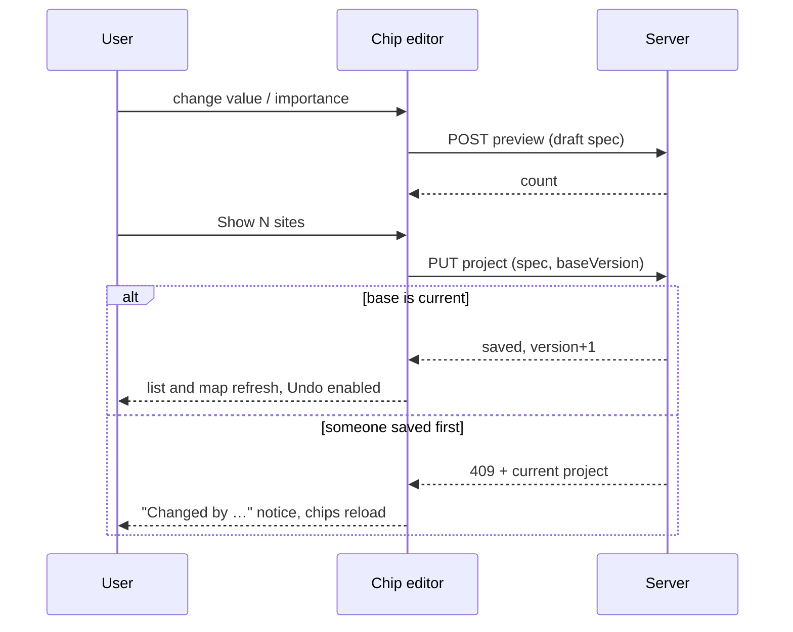

# Criteria Bar and Survey Sheet Redesign - Plan

## Goal Capsule

- **Objective:** Anyone, including a first-time user with no training, can say what site they want, see why each parcel ranks where it does, and change the search in one obvious place — in an app whose look reads as deliberately designed for land buyers, not as a generic web app.
- **Means:** One criteria bar that is the project (KTD1, KTD2), the "Survey sheet" visual language from the approved mockups (KTD8), and a quiet custom basemap (KTD9).
- **Authority:** Product Contract requirements win on behavior; KTDs win on mechanism; the mockups at https://claude.ai/artifact/RjAcWX6ac7z8DpnBnM1ezh illustrate, never override, the Rs. `docs/design-system.md` owns spacing, type and overlay sizes.
- **Execution profile:** One PR from a feature branch off `main`. Pushing `main` auto-deploys to Vercel, so nothing merges until the user has reviewed it locally.
- **Stop conditions:** Stop and ask if a change would alter stored spec data in a way existing Field House scores cannot be reproduced from (R11), or if the design-system doc contradicts the approved mockups.
- **Who finishes:** `ce-work` builds and verifies locally against the Neon `dev` branch; the user approves before merge and deploy.

---

## Product Contract

### Summary

Replace the two competing ways to set criteria (the left-side project editor and the top filter bar) with a single bar of Must and Nice chips that saves to the project, edited through one plain-language chip editor. Restyle every screen in the approved "Survey sheet" direction and give the map a quiet custom style.

### Problem Frame

Paydirt asks for the same thing in two places that disagree. Acres appear in both the project criteria and the top filters with different values, and nothing says which wins. Creating a project and editing it later use different screens and different vocabulary (requirements, preferences, weights in percent). The user wants a 10-year-old to be able to use it while it stays powerful. Separately, the interface reads as generic: soft rounded floating panels, thin lines between every list row, rounded grey tags. For CRE buyers that reads as cheap or auto-generated, which undercuts trust in the results.

### Requirements

**One set of criteria**

- R1. The map's top bar shows the project's criteria as chips and is the only place to view or change them; the left-side criteria editor is removed.
- R2. Each chip shows its value in plain words and whether it is Must (hides sites that don't fit), Nice (ranks sites higher), or both.
- R3. Nice importance is chosen as A little, Some or A lot; no weights or percentages appear on the main screens.
- R4. Five chips appear for every project (Size, Where, Zoning allows your use, What's on the site, Likely to sell); Families nearby, Land price and Only sites tagged are added through "+ Add".
- R5. Criteria Paydirt cannot check yet (drive time, buildable acres, zoning for other uses, listed for sale) are shown greyed as "not checked yet" with what is used instead, and their values are kept on the project.

**Editing safely**

- R6. Clicking a chip opens one editor that asks the value (with common presets), how much it matters (Must / Nice + importance / Doesn't matter), and shows the number of matching sites before applying.
- R7. Each applied change saves the project as a new version, with Undo and a visible History.
- R8. If someone else changed the project since you loaded it, your change is not silently lost: you are told and shown the current criteria.

**Search and status**

- R9. The search box finds an address, parcel number or town and moves the map and list; it never changes the project, and it also finds parcels the criteria hide, labeled with why they are hidden.
- R10. Status (saved, shortlist, contacted, passed) is filtered on the Saved page, not in the map bar; passed sites are hidden on the map by default with a way to show them.

**Starting and managing a project**

- R11. Existing projects keep their current scores until a chip is edited; Field House's ranking is unchanged by the upgrade itself.
- R12. On Home, a described site comes back as the same chips (editable before creating), including "not checked yet" items, and "Create" opens the map for the new project.
- R13. "Set criteria yourself" creates a project with the five standard chips unset and opens the map.
- R14. Renaming a project, editing its brief, duplicating it and revising it from a new brief are reachable from a project menu next to its name.

**Explaining scores**

- R15. The property pop-out and parcel panel show "Why it scores N" as a checklist against the project's own chips: Must chips met, Nice chips marked fully met, partly met or not met.

**Look and feel**

- R16. Every screen follows the Survey sheet rules in `docs/design.md`: paper ground, 0px corners, no floating rounded panels, no 1px dividers between list rows, heavy section rules, solid-block chips and buttons, mono uppercase labels.
- R17. The map uses a quiet custom style in the brand palette instead of the stock street map, in both light and dark themes.

### Key Decisions

- **The bar is the project, not a temporary filter.** (session-settled: user-approved — chosen over keeping temporary filters separate from the saved project: two systems were the original confusion.) Governs R1, R7.
- **Must / Nice with A little / Some / A lot.** (session-settled: user-approved — chosen over exposing numeric weights: weights were judged too technical for untrained users.) Governs R2, R3.
- **Survey sheet direction.** (session-settled: user-directed — chosen over Field atlas and Prospectus after reviewing all three mockups.) Governs R16.
- **Not-checked-yet criteria stay visible.** (session-settled: user-approved — chosen over hiding them so nobody wonders why a wish is missing.) Governs R5.

### Scope Boundaries

- No new data sources: buildable acres, drive time, other-use zoning and listings remain not checked (R5 shows them).
- No per-project permissions; all members of the default org can edit every project, as today.
- Considered and not built: a separate "sandbox" exploration mode. The live count in the chip editor (R6) covers trying a value before applying it; revisit if users report accidental saves.
- Considered and not built: merging rapid consecutive edits into one version. Each apply is one deliberate click; revisit if History becomes noisy.

#### Deferred to Follow-Up Work

- Applying `docs/design-system.md` beyond what U6 covers, if that doc lands after this PR.
- Interview-based project start inside the new Home flow (today's interview builder stays reachable from the project menu's "Revise").

### Deferred / Open Questions

- Decision: should the project menu (R14) keep only Rename and "Revise from a new brief", deferring Duplicate and a separate "Edit brief"? Each extra action needs new server and UI work, and the goal of keeping it simple argues for fewer. Recommended: yes.
- Proposed fix: reword R7 to "with Undo for your own last change and a visible History where any version can be restored", matching KTD4.

### Success Criteria

- A first-time user can create a project from a description and change one criterion without reading any help text.
- No screen shows weights, percentages or the words "requirement" or "preference".

---

## Planning Contract

### Key Technical Decisions

- KTD1. **A chip is a view over the existing spec, not a new storage format.** Each chip owns a fixed set of requirement fields (its Must part) and preference fields (its Nice part) in today's `spec` JSON, per the mapping table below; every field is owned by exactly one chip. Stored specs stay valid and R11 holds without a data migration. A chip can carry both parts, as Field House's Size does (must 5–80, best 13–40).
- KTD2. **Importance maps to fixed weights 10 / 25 / 50.** A chip's label is read from the summed weight of its preference fields, as the nearest of those three. Weights are rewritten only when the user changes that chip's importance (Must / Nice level); value-only edits keep the stored weight, so rankings move only when the user asked them to (R11). For a chip with several preference fields, a new importance rescales them to the canonical total, keeping their ratio (equal split when new).
- KTD3. **Saves carry the base version and are checked server-side.** `PUT /api/projects/:id` accepts the version the client edited from and returns 409 with the current project when it is stale (R8). `updateProject` runs in one transaction, and `project_spec_history` gets a unique (project_id, version) index so double clicks cannot create duplicate versions. The client sends one save at a time.
- KTD4. **Undo is "restore the previous version" as a new version.** It reuses history already returned by `GET /api/projects/:id`, saves with source `undo`, and is enabled only when the latest version was made by the current user; otherwise History shows who changed what.
- KTD5. **A count-only preview endpoint.** `POST /api/projects/:id/preview` compiles a draft spec and returns the number of matching sites without scoring or fetching rows (R6). It takes the map's current `hidePassed` value so "Show N sites" equals the rows the list then shows.
- KTD6. **Spec gains `pending` and keeps `why`.** `normalizeSpec` allows a `pending` list with fixed keys (`drive_time`, `buildable`, `other_use_zoning`, `listed_for_sale`) and their values, keeps each criterion's `why` text, and accepts a spec with only Must chips (every match then scores 100 and the list sorts by acres). Claude's draft schema in `src/compiler.js` returns `pending` items with those keys instead of free text (R5, R12).
- KTD7. **Non-criteria leave the bar.** Min score is dropped. Status moves to the Saved page. Passed sites are excluded on the map by default via a `hidePassed` view parameter, toggled under Layers (R10). Search text bypasses requirements and returns each hit with its existing `hiddenBecause` reasons (R9).
- KTD8. **Rewrite `public/styles.css` instead of layering again.** Keep the token block; replace the rest with sections per surface (rail, bar, list, panel, dialog, home, saved). Keep every class and id the JS depends on (derive the list by searching `public/*.js` for class and id selectors before deleting rules); remove dead `.topbar`, `.card`, override layers and `!important`. Values come from `docs/design-system.md`.
- KTD9. **Custom basemap chosen at page load.** A repo-hosted style JSON derived from the OpenFreeMap Liberty style, recolored to the palette, with a light and a dark variant picked when the page loads. Switching style at runtime would drop every added layer, so on map pages the theme toggle saves the choice and reloads the page.

### Chip to spec mapping

| Chip | Must part (requirement) | Nice part (preference) | Notes |
|---|---|---|---|
| Size | `acres` range | `acres` target min/max | Both parts common |
| Where | `area` list, `jurisdiction` set | none | Nice not offered |
| Zoning allows your use | `zoning.sports_facility` verdict set | `zoning.sports_facility` | Sports only today (R5) |
| What's on the site | `vacant`, `tags_exclude` | `vacancy`, `business_on_site` | Keep the business cap |
| Likely to sell | `owner_signals` any-of | `owner_signals` | Map bar's free-text signals to fixed keys |
| Families nearby | `hh200k_10mi` min | `hh200k_10mi` | Via + Add |
| Land price | `land_value_per_acre` max | `land_value_per_acre` | Via + Add |
| Only sites tagged | `tags_include` | none | Via + Add, expert |

### High-Level Technical Design

Applying a chip change (R6, R7, R8):

---

## Implementation Units

### U1. Chip model, versioned saves and preview on the server

- **Goal:** The server can describe a spec as chips, save chip edits safely and count a draft.
- **Requirements:** R2, R3, R5, R6, R7, R8, R11; KTD1–KTD6.
- **Dependencies:** none.
- **Files:** `src/spec.js`, `src/projects.js`, `src/server.js`, `src/compiler.js`, `db/schema.sql`, `package.json`, `test/criteria.test.js` (new).
- **Approach:**
  1. Add a chip catalog and two pure functions: spec → chips (labels, importance from nearest weight) and chip edit → spec.
  2. `normalizeSpec`: accept `pending`, keep `why`, allow Must-only specs.
  3. `updateProject` in a transaction with a base-version check; unique index on history (check for existing duplicate versions before adding it); `undo` source.
  4. `POST /api/projects/:id/preview` returning a count only.
  5. Draft schema returns `pending` with fixed keys.
- **Patterns to follow:** `compileSpec` and `REQUIREMENT_FIELDS` in `src/spec.js`; `wrap`/`projectOr404` in `src/server.js`.
- **Test scenarios:** (`node --test`; catches mapping and validation regressions, not UI)
  - Field House spec → chips shows Size with must 5–80 and nice 13–40, importance labels from weights 18/12/10/35/25.
  - Chips → spec → chips round-trips without changing an untouched chip's weight.
  - Editing only Field House's Size range leaves its stored weight unchanged.
  - A spec with only Must chips normalizes and every match scores 100.
  - `pending` with an unknown key is rejected; a known key keeps its value.
  - Saving with a stale base version returns 409 and the current project.
  - Two saves with the same base version produce one new version, not two.
  - Preview count for Field House's saved spec equals the list total from `projectCandidates` with the same `hidePassed` setting.
- **Verification:** Tests pass; Field House scores are identical before and after deploying U1.

### U2. Criteria bar and chip editor on the map

- **Goal:** The bar shows the project as chips and every change goes through the one editor.
- **Requirements:** R1–R8; KTD3, KTD4.
- **Dependencies:** U1.
- **Files:** `public/map.html`, `public/criteria.js` (new, shared chip rendering and editor), `public/candidates.js`, `public/builder.js`.
- **Approach:**
  1. Lay out the bar as in the Survey sheet mockup (`Main.dc.html`): row one holds the project name, search, Saved · vN · Undo · History and Layers; row two holds the chips, wrapping onto a further row when they don't fit.
  2. Render chips grouped Must / Nice / Not checked yet, then "+ Add". A chip appears once: in Must when it has a Must part, otherwise in Nice. A chip with both parts shows the Must value first and the Nice target with its importance word on a second line (for example "5–80 acres · best 13–40, A lot").
  3. One editor per chip, offering only the parts that chip supports:
     - Size: from–to acres with presets 5–10, 10–15, 15–25, 25+.
     - Where: towns to include, plus inside a city / unincorporated.
     - Zoning allows your use: permitted, allowed with a permit, not read yet.
     - What's on the site: vacant only, hide operating businesses, allow closing tenants, avoid major anchors.
     - Likely to sell: the owner signals as checkboxes.
     - Families nearby: at least N households earning $200k+ within 10 mi.
     - Land price: at most $ per acre.
     - Only sites tagged: tag checkboxes.
  4. Every editor asks how much it matters (Must / Nice + A little, Some, A lot / Doesn't matter), shows the live preview count and applies with "Show N sites". "Doesn't matter" returns a standard chip to unset (it stays visible); only chips added through "+ Add" leave the bar.
  5. States: the count shows a placeholder while loading and "Couldn't count — apply anyway?" on failure; zero reads "No sites match" with "Apply anyway"; on 409 the editor stays open showing the current criteria with the user's draft value kept for re-apply.
  6. History opens a dialog of versions, newest first (who, when, which chip changed), each with Restore, which saves as a new version like Undo. When Undo is unavailable it says "Last change was made by <name>".
  7. Remove the left editor (`renderCriteria`, `reqEditor`, `prefEditor`, `readCriteria`) and the bar's acres/zoning/site/signal/min-score/status inputs; keep the search input and Layers ids that `app.js` and `overlays.js` use.
- **Patterns to follow:** dialog handling in `public/property.js`; `api()` in `public/pages.js`.
- **Test scenarios:** (browser, local server on the dev database)
  - Clicking Size, setting 10–20, Must, shows a count, Apply saves v+1 and the list changes.
  - Switching Size to "Doesn't matter" leaves an unset Size chip; Undo restores the range.
  - Switching a "+ Add" chip to "Doesn't matter" removes it from the bar.
  - Editing in two tabs: the second apply shows the changed-by notice, keeps its draft value, and no criteria are lost.
  - A filter that matches nothing shows "No sites match" before applying.
  - A "not checked yet" chip opens read-only with the stored value and the fallback text.
  - The page has no remaining weight or percent text.
- **Verification:** All scenarios pass in the browser; `npm run build` passes. Field House's list widens from the old bar's 13–40 acres to its saved 5–80 range; per-parcel scores are unchanged.

### U3. Home start flow and project menu

- **Goal:** Starting and managing a project use the same chips and words as the map.
- **Requirements:** R12, R13, R14.
- **Dependencies:** U1, U2.
- **Files:** `public/index.html`, `public/start.js`, `public/criteria.js`, `public/map.html`, `public/candidates.js`.
- **Approach:** Render the draft with the shared chip renderer (editable before Create). While Claude drafts, show a progress message; on failure offer Retry and "Set criteria yourself". "Set criteria yourself" creates a project with unset standard chips; add a project menu by the project name (rename, edit brief, duplicate, revise from a brief, which reuses `builder.js`).
- **Patterns to follow:** current `public/start.js` create flow.
- **Test scenarios:**
  - A description with a drive time produces a greyed "Within 30 min drive" chip that survives Create.
  - Editing a draft chip before Create is reflected in the created project.
  - "Set criteria yourself" lands on the map with five unset chips and all sites listed.
  - Duplicate creates "Field House (copy)" with identical chips.
- **Verification:** Scenarios pass in the browser.

### U4. Search reaches hidden sites; status on the Saved page

- **Goal:** Search finds anything; status filtering lives with saved properties.
- **Requirements:** R9, R10; KTD7.
- **Dependencies:** U1.
- **Files:** `src/projects.js`, `src/spec.js`, `public/project.html`, `public/candidates.js`, `test/criteria.test.js`.
- **Approach:** When search text is present, skip requirement clauses and return `hiddenBecause` per row; list rows show "Hidden: …" labels. Make `failedRequirements` in `src/spec.js` evaluate owner signals (today it always passes them), so a site hidden by a Must "Likely to sell" chip is labeled. Add a status filter to the Saved page. Add `hidePassed` (default on) and a "Show passed sites" toggle under Layers.
- **Test scenarios:**
  - Searching a parcel number outside 5–80 acres returns it labeled "Hidden: size".
  - A parcel hidden only by a Must "Likely to sell" chip is labeled "Hidden: likely to sell".
  - A rejected site disappears from the map list and returns when "Show passed sites" is on.
  - The Saved page filters to Shortlist and back to All.
- **Verification:** Server test for the search case passes; browser scenarios pass.

### U5. "Why it scores" checklist

- **Goal:** Scores explain themselves against the project's own chips.
- **Requirements:** R15.
- **Dependencies:** U1.
- **Files:** `public/property.js`, `public/candidates.js`, `src/projects.js` (subscores per chip if not already exposed).
- **Approach:** Build rows from the chips: Must rows show the parcel's value with a check; Nice rows show fully met (≥80), partly met (40–79) or not met (<40) from the existing subscore; a chip with several preference fields uses their weight-averaged subscore.
- **Test scenarios:**
  - Parcel 132304-9010 shows Size ✓ 26.3 acres and Zoning ✓ permitted.
  - A Nice subscore of 55 shows "partly met"; 20 shows "not met".
- **Verification:** Pop-out and side panel show the same checklist for the same parcel.

### U6. Survey sheet stylesheet rewrite

- **Goal:** Every screen matches the approved direction.
- **Requirements:** R16; KTD8.
- **Dependencies:** U2, U3 (markup settles first).
- **Files:** `public/styles.css`, `public/index.html`, `public/map.html`, `public/project.html`, `docs/design.md`.
- **Approach:** Rewrite per KTD8; rail, bar, ledger list with rank numbers, square score tiles, flush panels, dialogs as solid frames with an ink header. Update `docs/design.md` to the Survey sheet rules.
- **Test expectation:** none -- styling; verified visually.
- **Verification:** Side-by-side with each mockup board; no element has a non-zero radius or a row divider; `rg 'border-radius|!important' public/styles.css` shows only intentional uses.

### U7. Custom basemap

- **Goal:** The map stops looking like a stock street map.
- **Requirements:** R17; KTD9.
- **Dependencies:** none.
- **Files:** `public/map-style-light.json`, `public/map-style-dark.json` (new), `public/app.js`, `public/property.js`.
- **Approach:** Derive both styles from Liberty with palette colors and fewer labels; select by theme at load in both map constructors; keep satellite, hillshade, candidate and parcel layers added on load.
- **Test expectation:** none -- visual; verified in both themes.
- **Verification:** Map loads in light and dark with all overlays toggling; the property pop-out map uses the same style.

---

## Verification Contract

| Gate | Command or check | Applies to |
|---|---|---|
| Build | `npm run build` (syntax, inline scripts, module imports) | All units |
| Unit tests | `npm test` running `node --test test/` (added in U1) | U1, U4 |
| Browser | Local server via `.claude/launch.json` on the Neon `dev` branch; scenarios per unit | U2–U7 |
| Score parity | Field House top 10 from `projectCandidates` with no bar filters identical before U1 and after U2 | U1, U2 |

---

## Definition of Done

- Every R1–R17 is met and each unit's verification passes.
- No weights, percentages, "requirement" or "preference" appear in the UI.
- Field House scores unchanged until a chip is edited.
- Dead code from the old editor, override CSS layers and abandoned attempts is removed.
- Changes reviewed locally by the user before merge to `main`.
